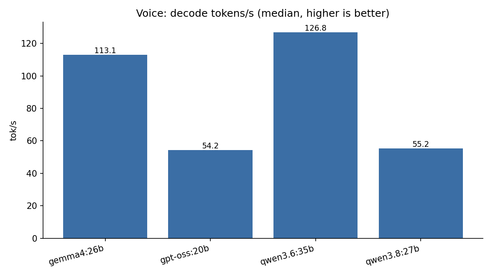
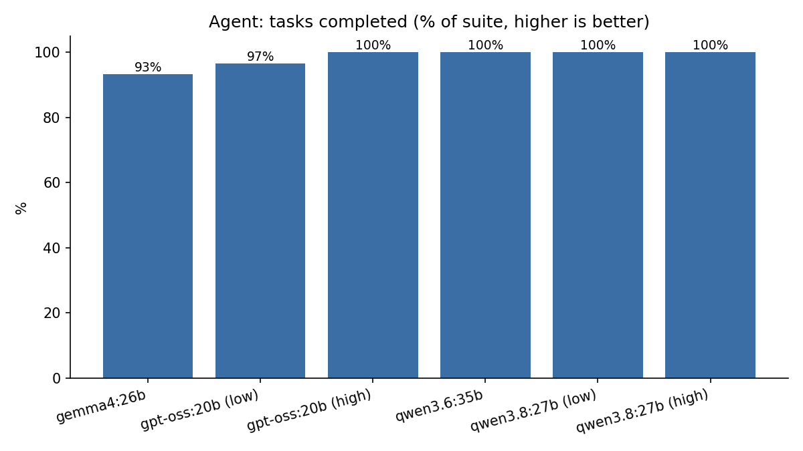

# local-llm-bakeoff

A small, config-driven, reproducible harness for comparing local open-weight models served by
[Ollama](https://ollama.com) on three workloads that matter for an always-on home assistant:

| suite | what it measures |
|---|---|
| **vision** | JSON-structured image captions: valid-JSON rate and seconds per image (public images only) |
| **voice** | streaming chat latency: time-to-first-token (TTFT) and decode tokens/s on 10 short spoken-style prompts |
| **agent** | tool use on synthetic planner/calendar/tracker tools: correct tool selected, correct arguments, task completed, valid tool-call JSON |

## Quick start

```bash
make install        # pyyaml + pytest
make test           # unit tests, no Ollama needed
make pull           # ollama pull every pinned tag in configs/default.yaml
make bench          # fetch public images, run all suites, write results/runs/*.json + RESULTS.md
make smoke          # quick sanity run on one small model
```

Pick models or suites: `python -m bakeoff.run configs/default.yaml --models gemma4:26b --suites voice,agent`.

## Method

- **Pinned models.** `configs/default.yaml` lists exact Ollama tags plus the first 12 hex of the
  model digest from the reference machine; the runner warns if your local digest differs.
- **Determinism.** Every request sets `seed` (default 42). Agent tasks run at temperature 0, vision 0.2,
  voice 0.6. Tool backends are deterministic fixtures defined in `configs/suites/agent.yaml`.
- **Vision.** Model must return `{"description", "activity", "people", "pets"}`; valid = parses and has
  the right types. Ollama `format: json` is requested and markdown fences are stripped.
- **Voice.** Streaming `/api/chat`; TTFT is wall-clock to first content token, tok/s is Ollama's
  `eval_count / eval_duration`. Thinking is disabled (or `low` for gpt-oss).
- **Agent.** Up to 6 tool-call rounds per task. Scores: *sel* (expected tools called), *args*
  (expected arguments present), *complete* (final answer contains the expected fact), *json_ok*
  (no malformed tool-call arguments). Thinking models are tested at each level in `think_levels`.
- Each model is unloaded (`keep_alive: 0`) before the next loads.

## Hardware

Mac Studio, Apple M3 Ultra, 256 GB unified memory, macOS, Ollama (Metal).

## Results (re-run 2026-10-15, 30 agent tasks, public images)

Ollama 0.40.2 on the M3 Ultra, seed 42, `--models gemma4:26b,qwen3.6:35b,gpt-oss:20b,qwen3.8:27b`.
Full tables in [RESULTS.md](RESULTS.md); charts in [`charts/`](charts/) (`python scripts/charts.py results/runs charts`).

| model | vision JSON valid | vision s/img (median) | voice TTFT (median) | voice tok/s | agent tasks complete (of 30) |
|---|---|---|---|---|---|
| qwen3.6:35b | 100% (2/2) | 2.73 | 0.06 s | 126.8 | 30 |
| gemma4:26b | 100% (2/2) | 1.75 | 0.08 s | 113.1 | 28 |
| qwen3.8:27b | 100% (2/2) | 6.64 | 0.20 s | 55.2 | 30 (low), 30 (high) |
| gpt-oss:20b | n/a (text only) | - | 0.39 s | 54.2 | 29 (low), 30 (high) |

 

Not re-run: gemma3:27b and gpt-oss:120b are not installed on the reference machine (disk); their
legacy numbers are below. Vision used only the 2 public images in `vision.yaml`; Ollama 0.40 rejects
`format: json` for these image models (HTTP 501), so the suite retries without it and records
`format_fallback: true`. Validity then relies on the prompt plus fence stripping.

## Legacy results (2026-10-12 to 10-14, 9 agent tasks, private frames)

See [RESULTS.md](RESULTS.md) for the generated tables (`make tables`). Highlights:

| model | vision JSON valid | vision s/img (median) | voice TTFT (median) | voice tok/s | agent tasks complete |
|---|---|---|---|---|---|
| gemma4:26b | 100% | 0.95 | 0.09 s | 91.0 | 9/9 |
| qwen3.6:35b | 100% | 1.15 | 0.07 s | 94.0 | 9/9 |
| qwen3.8:27b | 100% | 3.30 | 0.24 s | 40.7 | 9/9 (low and high) |
| gemma3:27b | 100% | 4.11 | 0.42 s | 24.7 | n/a (no native tools) |
| gpt-oss:120b | n/a (text only) | - | 0.60 s | 66.7 | 9/9 (low and high) |

## Caveats

- The legacy run used **private home-camera frames** for vision. Those images, their captions and
  raw outputs are deliberately **not** in this repo; only timings and validity flags were imported
  (`scripts/import_legacy.py`). Re-running `make bench` uses the public images in
  `configs/suites/vision.yaml` instead, so vision numbers will differ.
- Legacy agent results cover the first 9 tasks. Their prompts were lightly anonymized for the public
  suite (names, banks and appointments replaced), and 3 new tasks were added; re-run before comparing.
- gemma3:27b ran its agent tasks without native tool support, so its agent row is not comparable.
- Medians round half-up (`scoring.r1`); qwen3.8 legacy voice tok/s is exactly 40.65, which Python `round()` printed as 40.6 in older RESULTS.md. Now 40.7 everywhere.
- Vision sample is 2 images; add more public images to `vision.yaml` before drawing conclusions.
- Small sample sizes (legacy: 20 frames, 10 prompts, 9 tasks; re-run: 2 images, 10 prompts, 30 tasks); medians, not confidence intervals.
- gpt-oss:120b's first voice prompt includes model load time (TTFT ~37 s); the median excludes the effect.

## Layout

```
bakeoff/        harness (config, ollama client, suites, scoring, tables)
configs/        default.yaml (pinned models) + suites/*.yaml (prompts, tools, fixtures, images)
results/legacy  sanitized 2026-10-12 run    results/runs  your runs
scripts/        fetch_images.py, import_legacy.py
tests/          pytest, no Ollama required
```

## License

MIT, see [LICENSE](LICENSE).

## Cloudflare Pages (portfolio demo)

Static results site root: `site/`. Aggregate JSON: `demo/data/summary.json` (mirrored at `site/data/summary.json`).

Suggested Pages project: **local-llm-bakeoff** · Production branch `main` · Framework none · Root directory `site`.
